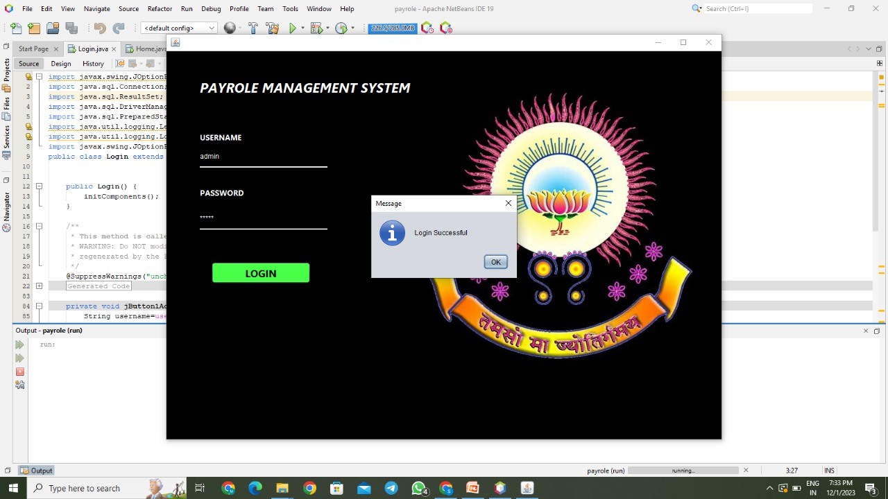
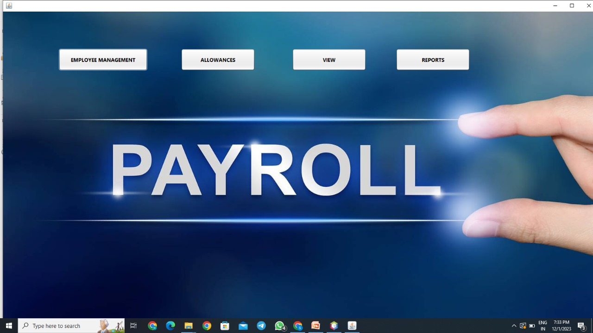
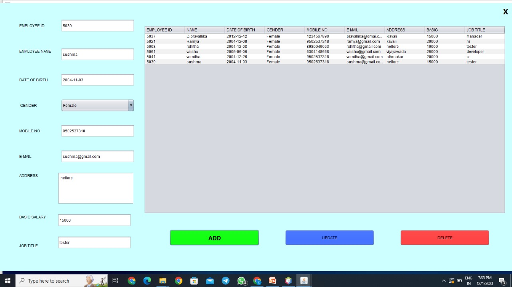
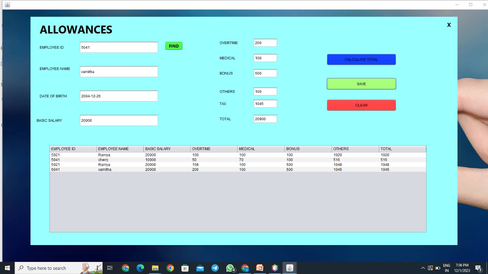
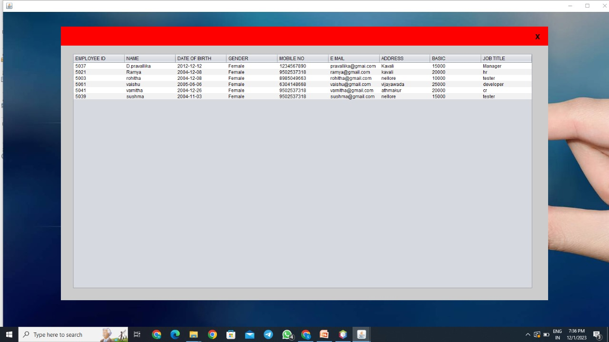
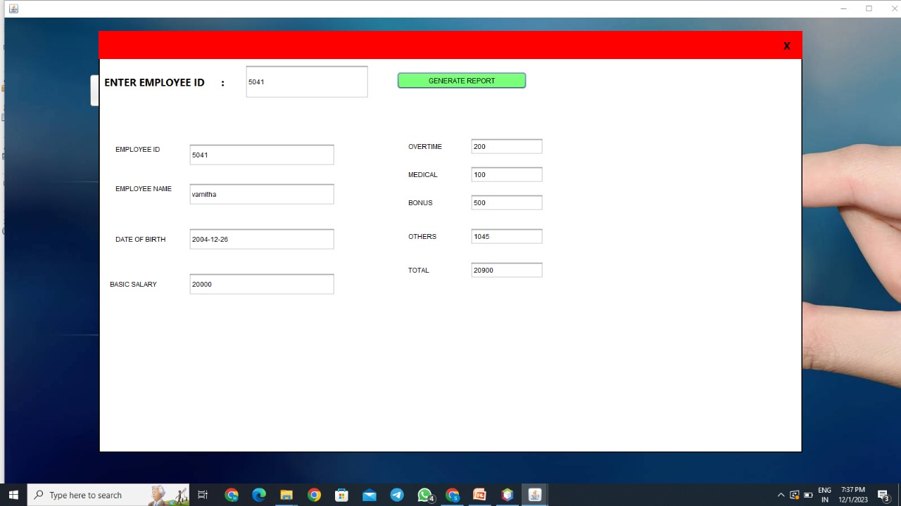

# Payroll Management System

## Overview
The Payroll Management System is a Java desktop application developed to manage employee details and payroll-related information. It provides a graphical user interface and uses MySQL to store and retrieve data.

## Technologies Used
- Java
- JDBC
- MySQL
- NetBeans IDE

## Features
- Login authentication
- Employee management
- Add, update, and delete employee records
- Allowances management
- View employee records
- Payroll-related reports
- Database connectivity using JDBC

## Modules

### 1. Login
Validates user login credentials against the database.

### 2. Home
Provides navigation to the different modules of the application.

### 3. Employee Management
Allows the user to add, update, and delete employee details.

### 4. Allowances
Manages employee allowance-related information.

### 5. View Employees
Displays employee records retrieved from the MySQL database.

### 6. Reports
Provides access to employee and payroll-related information.

## Database
MySQL is used as the database for storing application information. JDBC is used to connect the Java application to the database and execute SQL queries.

## How to Run the Project
1. Install Java JDK.
2. Install MySQL Server.
3. Open the project in NetBeans IDE.
4. Create the required database and tables.
5. Configure the database connection details in the source code.
6. Add MySQL Connector/J to the project Libraries.
7. Run the project from NetBeans.

## Project Screenshots
Screenshots of the application interface and output will be added here.

## Project Screenshots

### Login Page

### Home Page

### Employee Management

### Allowances

### View Employees

### Reports

